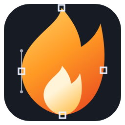
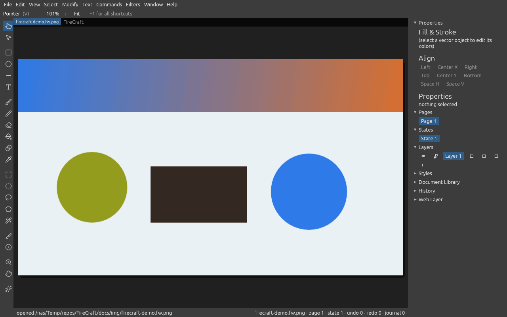

<div align="center">
  
  <h1>FireCraft</h1>
  <p><strong>Create. Edit. Design.</strong></p>
  <p>A modern, open-source graphics editor inspired by the workflows of Adobe Fireworks CS6.</p>
  <p>
    <a href="https://github.com/aliasfoxkde/FireCraft/releases/latest">Downloads</a> ·
    <a href="https://firecraft-web.pages.dev">Try the web build</a> ·
    <a href="docs/USAGE.md">Documentation</a> ·
    <a href="docs/NEXT.md">Roadmap</a>
  </p>
</div>

---

## About

FireCraft is an independent, clean-room reimplementation of the hybrid vector-and-bitmap graphics editor workflow associated with Adobe Fireworks. It is written in **Rust** and built around a shared document engine and command registry used by the desktop application, WebAssembly build, command-line interface, scripting host, and Model Context Protocol (MCP) server.

The goal is not to reproduce Adobe's code or redistribute its assets. The goal is to preserve the productive Fireworks-style workflow—precise vector and bitmap editing, layered documents, web-oriented export, and an integrated creative workspace—while improving portability, performance, automation, and long-term maintainability.

> **Trademark and independence notice:** Adobe, Fireworks, Photoshop, Illustrator, and Macromedia are trademarks or registered trademarks of Adobe Inc. FireCraft is an independent open-source project and is not affiliated with, sponsored by, or endorsed by Adobe. Those names are used only to describe compatible workflows and file formats.

## Project status

<strong>Latest published release: <a href="https://github.com/aliasfoxkde/FireCraft/releases/tag/v0.2.5">v0.2.5</a> · 3 November 2026</strong>

The workspace version is 0.2.5. Development continues beyond that release: the active roadmap includes editor reachability, daily-driver canvas workflows, and a dedicated CS6-inspired shell-fidelity campaign. FireCraft is functional software under active development—not yet a feature-complete replacement for every Fireworks CS6 workflow.

The current documented engine surface includes **245 registered commands** and a CS6 DOM parity matrix of **268 carried, 3 partial (evidence-gated), and 0 missing**. These figures describe the engine/DOM surface, not complete GUI parity: some commands are available through the command palette or automation surfaces before they have a corresponding menu or polished inspector workflow.

### What is implemented

- **Native document format:** Fireworks PNG (`.fw.png`) read/write, including preservation of unrecognized document nodes and chunks.
- **Import and export:** PNG, JPEG, GIF, BMP, TIFF, WebP, WBMP, SVG, and PSD workflows, with animated GIF import/export and web-oriented export workflows.
- **Vector editing:** paths, contours, Bézier handles, primitive shapes, boolean operations, gradients, fills, strokes, alignment, and arrangement.
- **Bitmap editing:** paint and retouch tools, pixel-selection modes, bitmap objects, and raster composition.
- **Canvas interaction:** transform handles, numeric transforms, path-node editing, gradient handles, guides, grid, snapping, zoom, and selection controls.
- **Text and symbols:** text objects and rich text attributes, symbol definitions and instances, nested symbol workflows, and nine-slice guides. In-canvas text editing remains on the roadmap.
- **Effects:** live effects and a filter surface backed by the compositor.
- **Automation:** a shared command registry, journal/replay, ExtendScript-compatible `.jsf` execution, headless CLI, browser `postMessage` bridge, and MCP server.
- **Web application:** a WebAssembly build using the same editor shell and engine as the native application.

### Current UI and parity work

The editor is being brought closer to the Fireworks CS6 workspace rather than treated as a generic graphics canvas. The active shell-fidelity work covers:

- A CS6-style menu and panel workflow, including movable, resizable, collapsible panels and persisted layout.
- Selection-aware canvas context menus.
- A CS6-oriented tool strip and panel inventory.
- A selection-aware Properties inspector with engine-backed editing.
- Remaining panel work, including Optimize, Common Library, CSS Properties, Find and Replace, and Slices.
- UI snapshot and interaction gates to prevent visual and behavioral regressions.

Some of these items are partially implemented or still planned. The authoritative, task-level status is maintained in [`docs/NEXT.md`](docs/NEXT.md); see its Phase 22 for the shell-fidelity campaign.

## Screenshots

The image below is a repository screenshot of the application. It is a point-in-time view; consult the roadmap for current implementation status.

<p align="center">
  
</p>

## Get started

### Download a release

Use the [latest GitHub release](https://github.com/aliasfoxkde/FireCraft/releases/latest) for published binaries and the WebAssembly bundle. The v0.2.5 release includes Linux x86_64 desktop and CLI archives, a Debian package, and a web bundle. Other platform packaging scripts are available in the repository, but a build recipe is not the same as a tested, published binary.

### Build from source

Requirements: a Rust toolchain compatible with the workspace's `rust-version`, plus the platform dependencies described in [`docs/TOOLCHAINS.md`](docs/TOOLCHAINS.md).

```sh
git clone https://github.com/aliasfoxkde/FireCraft.git
cd FireCraft

# Run the repository's full CI gate
cargo run -p xtask -- ci

# Build the native editor and CLI
cargo build --release -p app
cargo build --release -p app-cli

# Build the browser distribution
cargo run -p xtask -- dist --web
```

### CLI examples

```sh
# Inspect a document
cargo run -p firecraft-cli -- info artwork.fw.png

# Canonically re-emit a Fireworks PNG document
cargo run -p firecraft-cli -- convert input.fw.png output.fw.png

# Export a document
cargo run -p firecraft-cli -- export artwork.fw.png output.webp

# Import a raster image into a new Fireworks PNG document
cargo run -p firecraft-cli -- import photograph.jpg new-document.fw.png

# Start the MCP server for an existing document
cargo run -p firecraft-cli -- mcp artwork.fw.png
```

See [`docs/USAGE.md`](docs/USAGE.md) for the complete CLI, GUI shortcut, browser-embedding, and MCP reference.

## Architecture

FireCraft is organized around one document model and one command authority:

- **Engine and document model:** document state, editing commands, history, and serialization.
- **Composition and rendering:** deterministic CPU reference rendering and GPU-accelerated interactive canvas rendering.
- **I/O:** Fireworks PNG plus raster, vector, and layered interchange formats.
- **Application shell:** native and WebAssembly editor UI.
- **Automation surfaces:** CLI, scripting, journal/replay, browser bridge, and MCP.

The GUI and automation interfaces are intended to drive the same engine commands; this avoids maintaining separate editing semantics for each frontend.

## Documentation

| Document | Purpose |
|---|---|
| [Features](docs/FEATURES.md) | Implemented feature surface and evidence/gates |
| [Usage](docs/USAGE.md) | Build instructions, CLI, shortcuts, browser bridge, MCP |
| [Next / Roadmap](docs/NEXT.md) | Active phases, acceptance criteria, and open tasks |
| [Progress](docs/PROGRESS.md) | Session-level status and historical progress |
| [Planning](docs/PLANNING.md) | Product plan, file-format notes, and architecture |
| [Handoff](docs/HANDOFF.md) | Engineering handoff and agent runbook |
| [Toolchains](docs/TOOLCHAINS.md) | Platform toolchains and packaging recipes |
| [WebOS](docs/WEBOS.md) | Browser embedding contract |
| [Attribution](docs/ATTRIBUTION.md) | Third-party asset and license ledger |

## Brand and assets

The FireCraft mark is original project artwork: a fox/flame motif representing creative energy and precision. It is not an Adobe or Fireworks asset. The mark uses an ember-orange and gold gradient on a charcoal field; the SVG is the canonical scalable logo source.

Third-party assets must retain their license notices and be recorded in [`docs/ATTRIBUTION.md`](docs/ATTRIBUTION.md). FireCraft's source is licensed under Apache-2.0.

## License

Licensed under the [Apache License 2.0](LICENSE).
