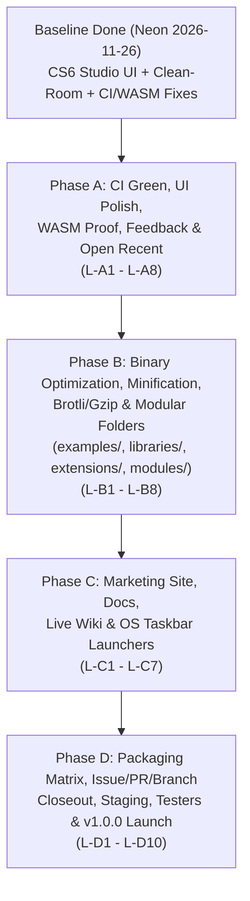

# FireCraft 1.0 — Master Execution Plan, Roadmap & GPT-6-Luna Handoff

> **Prepared by:** Neon Forensic Audit & Integration Pass (2026-11-26)
> **Designed for:** **GPT-6-Luna** (disciplined, instruction-following execution agent working strictly one atomic task card at a time)
> **Canonical repository:** `/nas/Temp/repos/FireCraft` (`https://github.com/aliasfoxkde/FireCraft`)
> **Active integration worktree:** `/var/tmp/firecraft-int-1.0` on branch `integration/firecraft-1.0` (PR `#189`)
> **Read-only UI reference:** `/nas/Temp/repos/FireCraft-CraftAnything-Experiment` *(NEVER edit, reset, or copy proprietary assets from here)*
> **Authoritative live task ledger:** [`docs/TASKS.md`](../../TASKS.md)
> **Atomic Luna progress & receipt ledger:** [`docs/planning/luna/PROGRESS.md`](PROGRESS.md)

---

## 1. Executive Audit Summary — What Happened & Why Work Was Redirected

A full forensic audit of code, git history, screenshots, CI logs, and prior session directives identified **every root cause of the earlier Hydrogen execution failure** and reconciled **every dropped user request**:

| Prior User Request / Area | What Happened Under Hydrogen | Status After Neon Audit & Core Fixes | Owner Going Forward |
|---|---|---|---|
| **CS6 Studio UI from CraftAnything Experiment (`T29`) & Phosphor Icons** | `feat/experiment-merge` (`3f41fb5b`) added helper files without wiring them into `Shell::ui()`. Left 7 panels as 3-line stubs, `welcome_overlay.rs` dead, broken light-gray egui buttons, only 57 Phosphor SVGs wired in flyouts, and produced a ~5–10% ugly Windows `.exe`. | **CORE FIXED & WIRED.** Extracted clean-room `theme.rs`, `vector_icons.rs`, `chrome.rs`, `demo.rs`, `welcome_overlay.rs`, `panel_windows.rs` (4 stacked CS6 dock groups + 36 px Iconic Mode), and replaced all 7 stubs in `panels.rs`. `278/278` app tests + `184/184` xtask tests + `clippy -D warnings` + `wasm32` + all 6 `xtask` gates green. | **Phase A** (unify **Phosphor Icons** across the entire GUI, floating drag ghost, Playwright WASM proof, keyboard/a11y polish, Windows 11 human sign-off) |
| **Binary Optimization (minification, name stripping, compression) & Modular Folder Split (`extensions/`, `examples/`, `libraries/`, lazy `modules/`) (`T31` + `0090`)** | Recorded in `docs/tasks/T31-modular-packaging-and-wasm-size.md` (`17438502`), then **completely dropped** from Hydrogen's handoff! Worse: Hydrogen deleted `<link data-trunk rel="rust" data-bin="firecraft-web" data-wasm-opt="z"/>` from `web/index.html` (`10187ec0`) and left `xtask/src/dist.rs` `.gz` matching broken (`&[".wasm", ".js", ".html"]` with leading dots — a 100% no-op!). | **BOTH REGRESSIONS FIXED** + regression unit tests added in `xtask/src/dist.rs`. Full measured size optimization + JS minification/mangling + Brotli/Gzip + retiring `egui_extras/svg` WASM bloat + splitting `examples/`, `libraries/`, `extensions/`, and lazy WASM `modules/` promoted to dedicated **Phase B**. | **Phase B** (`L-B1` through `L-B8`) |
| **Native Taskbar / Dock Launcher & Open Recent / Pinned (`T30`)** | Recorded in `docs/tasks/T30-taskbar-launcher-menu.md` (`17438502`), then dropped from Hydrogen's handoff. | Restored and split cleanly into cross-platform MRU/Pinned (`L-A6`) + OS-native Jump List / Dock / `.desktop` adapters (`L-C6`) respecting `unsafe_code = "forbid"`. | **Phase A (`L-A6`) & Phase C (`L-C6`)** |
| **Clean-Room & CI Integrity** | `crates/app/src/shell/constants.rs` carried forbidden binary/subroutine notes; `xtask/src/dist.rs` broke Windows MSVC (`PermissionsExt` ungated); `xtask/src/iconsurvey.rs` broke `the_survey_lists_every_shipped_icon`; `cargo fmt` failed on `diagnostic.rs`. | **ALL FIXED.** Clean-room comments scrubbed, `#[cfg(unix)]` gated in `dist.rs`, `iconsurvey.rs` prefix threaded, `cargo fmt --all` clean, `xtask aegis` green. | **Phase A (`L-A1`)** verify PR `#189` CI green |
| **Marketing Site, Docs, Live Wiki, Packaging Matrix, 31 Issues / 3 PRs / Branches, Feedback & `v1.0.0` Launch** | Hydrogen partially touched `site/` and `diagnostic.rs`, left multi-page site, feedback dialog UI, wiki sync, packaging hardening, and issue closeout unfinished, and falsely claimed completion. | Honestly audited and re-sequenced into zero-ambiguity atomic tasks with strict visual/CLI verification gates. | **Phases A, C, D** |

---

## 2. How GPT-6-Luna Must Operate (Read First Every Session)

### 2.1 The 7-Step Atomic Execution Loop
Work on **at most 1 to 3 consecutive `[LUNA]` tasks** in the same phase per session. Never skip ahead. Never batch across a `[HUMAN GATE]`.

1. **Read current state:** Open `docs/planning/luna/PROGRESS.md` and pick the **first unchecked `[ ]` task ID** (e.g., `L-A1`).
2. **Open ONLY that phase's task pack:**
   - Phase A -> [`PHASE-A-CI-UI-AND-POLISH.md`](PHASE-A-CI-UI-AND-POLISH.md)
   - Phase B -> [`PHASE-B-OPTIMIZATION-AND-MODULAR-LAYOUT.md`](PHASE-B-OPTIMIZATION-AND-MODULAR-LAYOUT.md)
   - Phase C -> [`PHASE-C-DOCS-SITE-AND-WIKI.md`](PHASE-C-DOCS-SITE-AND-WIKI.md)
   - Phase D -> [`PHASE-D-PACKAGING-RELEASE-AND-CLOSEOUT.md`](PHASE-D-PACKAGING-RELEASE-AND-CLOSEOUT.md)
3. **Run the task's `Pre-check` command verbatim.** If reality contradicts the assumption, **STOP** and record a blocker in `PROGRESS.md`.
4. **Execute ONLY the steps in that task card.** Do not touch unrelated crates, refactor unrelated files, or invent unrequested features.
5. **Prove runtime wiring + visual evidence (mandatory for UI / web / site tasks):**
   - **Wiring check:** Verify via `grep` + unit/integration test that the live entrypoint (`Shell::ui()`, `main.rs`, `web/src/main.rs`, or `site/*.html`) actually invokes your new code. Never merge dead modules or text stubs.
   - **Visual check:** Whenever editing `crates/app/src/shell/`, `web/`, or `site/`, capture a real PNG screenshot (via `xvfb-run` for desktop or Playwright for web/site) and **inspect the image directly** before claiming completion.
6. **Run the task's `Verify` command verbatim** (using `ssh fedora` for Cargo/xtask gates; see §3). Exit code MUST be `0`.
7. **Commit, push, and log receipt:**
   - Format with `cargo fmt --all`.
   - Commit with Conventional Commits (`<type>(<scope>): <subject>`, subject `<= 72` chars, `Co-Authored-By` trailer).
   - Push **`gitforge` first**, then **`origin`** (once verified green).
   - Update `docs/planning/luna/PROGRESS.md` (mark `[x]` + append dated receipt row with commit SHA, exact command, exit code `0`, and 1-line observed result) AND update `docs/TASKS.md` if a tracked task changed status.
   - If the next task is a **`[HUMAN GATE]`**, **STOP IMMEDIATELY**, summarize the evidence bundle for the maintainer, and wait for explicit approval.

### 2.2 Hard Stop Rules (Anti-Hydrogen Guardrails — NEVER Violate)
1. **NO FALSE COMPLETION:** Never mark `[x]` without running the exact `Verify` command on the final commit and observing exit code `0`.
2. **NO SELF-APPROVAL OF HUMAN GATES:** Never merge your own PR, close issues without evidence, publish a GitHub Release (`--draft=false`), push to production Cloudflare Pages, or delete branches/stashes without explicit maintainer sign-off.
3. **NO SSH/RSYNC CODE SYNC:** Never copy source trees over `rsync` or `scp`. Always `git commit` -> `git push gitforge <branch>` (and `origin` when verified) -> `git pull --ff-only` on the remote build host (`fedora` or `t5500`).
4. **NO HEAVY LOCAL CARGO BUILDS ON SWARMONE:** Local host enforces a build lease; offload Cargo tests, clippy, `xtask`, Linux release builds, and WASM builds to `ssh fedora`, and Windows MinGW review builds to `ssh t5500`.
5. **CLEAN-ROOM & SAFETY INVARIANTS (`AGENTS.md`):**
   - `unsafe_code = "forbid"` workspace-wide.
   - Zero `unwrap()`, `expect()`, `panic!()`, `todo!()`, `unimplemented!()`, `unreachable!()`, `dbg!()`, `println!()` in non-test Rust code.
   - Never copy Adobe code, binary assets, trademarks, or disassembly/subroutine addresses (`sub_*`, `0x...`).
   - Never commit anything from `source/`, `/var/tmp/`, `.env`, tokens, passwords, raw LAN IPs, or binary build outputs (`*.exe`, `*.wasm`, `*.AppImage`, `*.deb`).
   - **Aegis tip:** Aegis scans for US 5-digit ZIP codes in tracked text/code — write numeric literals >= 10,000 in Rust with underscores (e.g., `65_535.0`, `10_000`) and run `cargo run -p xtask -- aegis` before pushing to `origin`!
6. **HONEST ENGINEERING ON OPTIMIZATION (`T31` + `0090`):**
   - Always report same-SHA before/after bytes for **raw WASM**, **Gzip (`.gz`)**, **Brotli (`.br`)**, **JS glue**, **HTML**, and **initial vs deferred network transfer**.
   - Rust variable names are NOT emitted as JS-style identifiers in release WASM; use `wasm-opt -Oz --strip-debug --strip-dwarf --strip-producers` + `strip` for Rust/WASM, and real JS minification/mangling (`esbuild`/`terser`) for generated JavaScript glue and site scripts.
7. **2-ATTEMPT STOP RULE:** If the same `Verify` command fails twice after one targeted fix attempt, **STOP**, write the exact error log under **Blockers** in `PROGRESS.md`, and escalate to the maintainer.
8. **GIT SAFETY:** Never run `git reset --hard`, `git clean -fd`, `git push --force`, `git stash drop`, `git stash pop`, or `git branch -D`.

---

## 3. Build Fleet & Verification Cheat Sheet

| Host / Path | Purpose | Repo Path & Target Dir | Git Upstream |
|---|---|---|---|
| **Local (`SWARMONE`)** | Editing, git commits/pushes, Playwright/site scripts, `xvfb-run` GUI screenshots | Worktree: `/var/tmp/firecraft-int-1.0` (`integration/firecraft-1.0`)<br/>Canonical: `/nas/Temp/repos/FireCraft` | Remotes: `gitforge` (push first), `origin` (GitHub) |
| **`ssh fedora`** | All Cargo tests, `clippy -D warnings`, `wasm32-unknown-unknown`, `xtask` gates, `trunk` WASM builds, Linux release builds | Repo: `/var/tmp/firecraft-int-1.0-git`<br/>`CARGO_TARGET_DIR=/var/tmp/firecraft-target-fedora` | Pulls from `gitforge` (`origin` on fedora points to GitForge) |
| **`ssh t5500`** | Windows `x86_64-pc-windows-gnu` review `.exe` builds (MinGW cross-toolchain installed) | Repo: `/var/tmp/firecraft-int-1.0-git`<br/>`CARGO_TARGET_DIR=/var/tmp/firecraft-target-t5500` | Pulls from GitHub `origin` (push to `origin` first!) |

### Copy-Paste Standard Verification Recipes

**1. Full Fedora verification gate (run after pushing to `gitforge`):**
```bash
ssh fedora 'export PATH="$HOME/.cargo/bin:$PATH"; export CARGO_TARGET_DIR=/var/tmp/firecraft-target-fedora; cd /var/tmp/firecraft-int-1.0-git && git pull --ff-only origin integration/firecraft-1.0 && cargo test -p app && cargo test -p xtask && cargo clippy -p app -p xtask --all-targets -- -D warnings && cargo check --target wasm32-unknown-unknown -p firecraft-web && cargo run -p xtask -- layers && cargo run -p xtask -- toolchain && cargo run -p xtask -- panel-snapshot && cargo run -p xtask -- reachability && cargo run -p xtask -- icon-survey && cargo run -p xtask -- aegis'
```

**2. Desktop GUI screenshot capture (after building `--release -p app` on `fedora` and copying binary to `/var/tmp/firecraft-linux-check/firecraft`):**
```bash
xvfb-run -a -s "-screen 0 1440x900x24" bash -c '
  LIBGL_ALWAYS_SOFTWARE=1 /var/tmp/firecraft-linux-check/firecraft --no-welcome &
  PID=$!; sleep 4
  import -window root /var/tmp/firecraft-linux-check/shot-workspace.png
  kill $PID 2>/dev/null || true
'
```

**3. Windows review binary build on `t5500` (after pushing verified branch to `origin`):**
```bash
ssh t5500 'export PATH="$HOME/.cargo/bin:$PATH"; export CARGO_TARGET_DIR=/var/tmp/firecraft-target-t5500; cd /var/tmp/firecraft-int-1.0-git && git pull --ff-only origin integration/firecraft-1.0 && cargo build --release --target x86_64-pc-windows-gnu -p app'
scp t5500:/var/tmp/firecraft-target-t5500/x86_64-pc-windows-gnu/release/firecraft.exe /nas/Temp/repos/FireCraft/dist/windows-review/firecraft.exe
sha256sum /nas/Temp/repos/FireCraft/dist/windows-review/firecraft.exe
```

---

## 4. Master Phase Roadmap



| Phase | Goal | Task IDs | Task Pack | Human Gates |
|---|---|---|---|---|
| **Phase A** | Land PR `#189` CI green, Playwright WASM proof, floating drag ghost, In-App Feedback dialog, Command Palette upgrade, `Open Recent`/Pinned, Windows 11 review | `L-A1`–`L-A8` | [`PHASE-A-CI-UI-AND-POLISH.md`](PHASE-A-CI-UI-AND-POLISH.md) | `L-A1` (merge PR `#189`), `L-A8` (Phase A sign-off) |
| **Phase B** | Twiggy size baseline, `wasm-opt -Oz` stripping, `egui_extras/svg` WASM diet, JS minification/mangling, Brotli `.br` + Gzip `.gz`, modular folders (`examples/`, `libraries/`, `extensions/`, lazy WASM `modules/`) | `L-B1`–`L-B8` | [`PHASE-B-OPTIMIZATION-AND-MODULAR-LAYOUT.md`](PHASE-B-OPTIMIZATION-AND-MODULAR-LAYOUT.md) | `L-B8` (size report & modular layout review) |
| **Phase C** | Multi-page `site/` + preview deploy, README/docs reconciliation, live GitHub Wiki sync, contributor templates, OS-native Taskbar/Dock launchers (`T30.3`–`T30.5`) | `L-C1`–`L-C7` | [`PHASE-C-DOCS-SITE-AND-WIKI.md`](PHASE-C-DOCS-SITE-AND-WIKI.md) | `L-C3` (site prod deploy), `L-C5` (wiki push) |
| **Phase D** | Scope decision (`0130`), full cross-platform packaging (Linux DEB/tar/AppImage/Flatpak, Windows ZIP/Inno, macOS DMG, Web ZIP, Source, SBOM), 31 issues / PRs / branches closeout, staging + external testers, `v1.0.0` launch | `L-D1`–`L-D10` | [`PHASE-D-PACKAGING-RELEASE-AND-CLOSEOUT.md`](PHASE-D-PACKAGING-RELEASE-AND-CLOSEOUT.md) | `L-D1`, `L-D6`, `L-D8`, `L-D10` |

---

## 5. Copy-Paste Starter Prompt for GPT-6-Luna Sessions

Use this exact prompt when starting any fresh GPT-6-Luna session:

```text
Read these 3 files in order before doing anything:
1. /var/tmp/firecraft-int-1.0/AGENTS.md
2. /var/tmp/firecraft-int-1.0/docs/planning/luna/README.md
3. /var/tmp/firecraft-int-1.0/docs/planning/luna/PROGRESS.md

Find the FIRST unchecked [ ] task ID in docs/planning/luna/PROGRESS.md and open ONLY its matching PHASE-*.md task pack under docs/planning/luna/.
Execute strictly 1 to 3 consecutive [LUNA] tasks in that phase (stop immediately before any [HUMAN GATE]).
Obey every rule in README.md §2:
- Run each task's Pre-check and Verify commands verbatim (use ssh fedora for Cargo/xtask builds; never run heavy builds locally or rsync code).
- For any UI, web, or site task, prove live wiring and capture + inspect a real PNG screenshot before marking done.
- Run cargo fmt --all and xtask aegis before pushing; push gitforge first, then origin.
- Update docs/planning/luna/PROGRESS.md with dated receipts (commit SHA, command, exit 0, 1-line result) and keep docs/TASKS.md reconciled.
- Stop and report clearly if a verify check fails twice or you reach a [HUMAN GATE].
```
