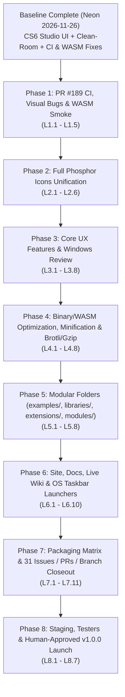

# FireCraft 1.0 — Master Roadmap & GPT-6-Luna Execution Handoff

> **Prepared by:** Neon Forensic Audit & Integration Pass (2026-11-26)
> **Target executor:** **GPT-6-Luna** (excels at strictly following narrow, single-goal, verifiable task cards)
> **Canonical repo & branch:** `/nas/Temp/repos/FireCraft` on branch `integration/firecraft-1.0` (PR `#189`) — all work MUST be committed in the repo and pushed to `gitforge` + `origin` (never keep unversioned work in `/var/tmp`)
> **Read-only UI reference:** `/nas/Temp/repos/FireCraft-CraftAnything-Experiment` *(NEVER edit or copy proprietary assets)*
> **Atomic checklist & receipts:** [`PROGRESS.md`](PROGRESS.md) · **Live repo board:** [`docs/TASKS.md`](../../TASKS.md)

---

## 1. How GPT-6-Luna Must Work (6-Step Atomic Loop)

Work on **1 task card at a time** (at most 2–3 consecutive `[LUNA]` tasks in the same phase per session). **NEVER** cross a `[HUMAN GATE]`.

1. **Pick next task:** Open [`PROGRESS.md`](PROGRESS.md) and locate the **first `[ ]` task ID** (e.g., `L1.1`).
2. **Open ONLY that phase file** from the table in §4 below. Read ONLY that task card.
3. **Run `Pre-check` verbatim.** If output contradicts the card, **STOP** and log it under `Blockers` in `PROGRESS.md`.
4. **Execute ONLY the listed bullets** in `Do`, touching ONLY the files named in `Files` (unless a compiler error proves an extra file is required).
5. **Prove runtime wiring + visuals (for any UI / icon / web / site task):**
   - Confirm live entry points (`Shell::ui()`, `main.rs`, `web/`, `site/`) invoke your change.
   - Capture real PNG screenshots (`xvfb-run` or Playwright) and **inspect them visually** before marking done.
6. **Verify, commit, push, log receipt:**
   - Run `cargo fmt --all`.
   - Push to `gitforge` first (`git push gitforge <branch>`).
   - Run the card's `Verify` command verbatim on `ssh fedora` (exit code MUST be `0`).
   - Push to `origin` once verified green (`git push origin <branch>`).
   - Mark `[x]` in `PROGRESS.md` + append a 1-line receipt (`Date | Task ID | Commit SHA | Verify result`), and update `docs/TASKS.md` if a tracked item changed.

---

## 2. Non-Negotiable Hard Rules (Anti-Failure Guardrails)

- **No false `[x]`:** Never mark a task complete without exit code `0` on the final commit.
- **No stale/cached artifacts (CRITICAL):** NEVER unzip, copy, or redeploy an older GitHub Release archive (e.g. `v0.2.5`) to Cloudflare Pages! Always run `xtask dist --web` fresh from HEAD and verify `curl -sSL https://firecraft-web.pages.dev/index.html` matches the newly generated `.wasm` hash AND capture + inspect a real live browser screenshot.
- **Single branch discipline:** Before editing any file, run `git branch --show-current` and verify you are on the active branch (never edit closed `feat/experiment-merge`).
- **No self-approving `[HUMAN GATE]`:** Always stop and report the exact evidence bundle to the maintainer.
- **No `rsync` / SSH code sync:** Always `git commit` -> `git push gitforge` (and `origin` when verified) -> `git pull --ff-only` on `fedora` / `t5500`.
- **No heavy Cargo builds on local `SWARMONE`:** Local host enforces a build lease. Run all Cargo tests, clippy, `xtask`, Linux builds, and WASM builds on `ssh fedora`; run Windows `.exe` builds on `ssh t5500`.
- **Clean-room & Rust safety (`AGENTS.md`):**
  - `unsafe_code = "forbid"` everywhere.
  - Zero `unwrap()`, `expect()`, `panic!()`, `todo!()`, `unimplemented!()`, `unreachable!()`, `dbg!()`, `println!()` in non-test Rust code.
  - Zero Adobe assets, trademarks, or disassembly comments (`sub_*`, `0x...`).
  - Never commit `source/`, `/var/tmp/`, secrets, passwords, LAN IPs, or compiled binaries (`*.exe`, `*.wasm`, `*.deb`).
  - **Aegis hygiene:** Write numeric Rust literals >= 10,000 with underscores (`65_535.0`) and run `cargo run -p xtask -- aegis` before pushing to `origin`.
- **Honest size claims (`T31` + `0090`):** Always record same-SHA before/after bytes for raw `.wasm`, `.gz`, `.br`, `.js`, `.html`, and startup vs lazy network transfer.
- **2-Attempt Stop Rule:** If the same `Verify` command fails twice after one targeted fix, **STOP**, log exact error lines in `PROGRESS.md`, and escalate.
- **Git safety:** Never run `git reset --hard`, `git clean -fd`, `git push --force`, `git stash drop`, `git stash pop`, or `git branch -D`.

---

## 3. Build Fleet & Standard Verification Commands

| Host | Role | Directory & Target | Pulls From |
|---|---|---|---|
| **Local (`SWARMONE`)** | Edit files, `cargo fmt`, git commit/push, Playwright/site scripts, `xvfb-run` screenshots | `/nas/Temp/repos/FireCraft` (`integration/firecraft-1.0`) | Pushes `gitforge` first, then `origin` |
| **`ssh fedora`** | Cargo tests, clippy, `wasm32`, `xtask` gates, Linux builds, WASM builds | `/nas/Temp/repos/FireCraft-git`<br/>`CARGO_TARGET_DIR=/var/tmp/firecraft-target-fedora` | `gitforge` (`origin` on fedora) |
| **`ssh t5500`** | Windows `x86_64-pc-windows-gnu` `.exe` builds + Debian-glibc Linux builds for local `xvfb-run` | `/nas/Temp/repos/FireCraft-git`<br/>`CARGO_TARGET_DIR=/var/tmp/firecraft-target-t5500` | GitHub `origin` |

**Standard Fedora gate:**
```bash
ssh fedora 'export PATH="$HOME/.cargo/bin:$PATH"; export CARGO_TARGET_DIR=/var/tmp/firecraft-target-fedora; cd /nas/Temp/repos/FireCraft-git && git pull --ff-only origin integration/firecraft-1.0 && cargo test -p app && cargo test -p xtask && cargo clippy -p app -p xtask --all-targets -- -D warnings && cargo check --target wasm32-unknown-unknown -p firecraft-web && cargo run -p xtask -- layers && cargo run -p xtask -- toolchain && cargo run -p xtask -- panel-snapshot && cargo run -p xtask -- reachability && cargo run -p xtask -- icon-survey && cargo run -p xtask -- aegis'
```

**Standard `xvfb-run` GUI screenshot (using Debian-glibc binary built on `t5500` and copied to `/var/tmp/firecraft-linux-check/firecraft-t5500`):**
```bash
xvfb-run -a -s "-screen 0 1440x900x24" bash -c '
  LIBGL_ALWAYS_SOFTWARE=1 /var/tmp/firecraft-linux-check/firecraft-t5500 --no-welcome &
  PID=$!; sleep 4
  import -window root /var/tmp/firecraft-linux-check/shot-workspace.png
  kill -9 $PID 2>/dev/null || true
'
```

**Standard Windows review binary build (after pushing to `origin`):**
```bash
ssh t5500 'export PATH="$HOME/.cargo/bin:$PATH"; export CARGO_TARGET_DIR=/var/tmp/firecraft-target-t5500; cd /nas/Temp/repos/FireCraft-git && git pull --ff-only origin integration/firecraft-1.0 && cargo build --release --target x86_64-pc-windows-gnu -p app'
scp t5500:/var/tmp/firecraft-target-t5500/x86_64-pc-windows-gnu/release/firecraft.exe /nas/Temp/repos/FireCraft/dist/windows-review/firecraft.exe
file /nas/Temp/repos/FireCraft/dist/windows-review/firecraft.exe && sha256sum /nas/Temp/repos/FireCraft/dist/windows-review/firecraft.exe
```

---

## 4. 8-Phase Master Roadmap



| Phase | Pack File | Scope | Tasks | Human Gates |
|---|---|---|---|---|
| **1** | [`PHASE-1-CI-AND-VISUAL-POLISH.md`](PHASE-1-CI-AND-VISUAL-POLISH.md) | PR `#189` CI green + merge, fix 3 visually-caught UI glitches, Playwright WASM smoke | `L1.1`–`L1.5` | `L1.1` (merge PR `#189`) |
| **2** | [`PHASE-2-PHOSPHOR-ICONS.md`](PHASE-2-PHOSPHOR-ICONS.md) | Audit & vendor missing MIT Phosphor icons, unify Tools/Toolbar/Tabs/Footer/Panels/Align/Path, Dark/Light/HiDPI proof | `L2.1`–`L2.6` | `L2.6` (icon visual sign-off) |
| **3** | [`PHASE-3-CORE-UX-FEATURES.md`](PHASE-3-CORE-UX-FEATURES.md) | Drag ghost & edge snap (`P2.6`), Feedback modal (`P8.2`), Command Palette discovery, `Open Recent`/Pinned + CLI (`T30.1–T30.2`), Windows review `.exe` | `L3.1`–`L3.8` | `L3.8` (Windows 11 review) |
| **4** | [`PHASE-4-BINARY-AND-WASM-OPT.md`](PHASE-4-BINARY-AND-WASM-OPT.md) | `twiggy` baseline, web profile + `wasm-opt -Oz --strip-*`, build-time Phosphor atlas/font (drops runtime `resvg`), font audit, JS minification/mangling, Brotli `.br` + Gzip `.gz` | `L4.1`–`L4.8` | `L4.8` (size report sign-off) |
| **5** | [`PHASE-5-MODULAR-FOLDERS-AND-EXTENSIONS.md`](PHASE-5-MODULAR-FOLDERS-AND-EXTENSIONS.md) | Split `examples/`, `libraries/`, desktop+WASM lazy loader, `extensions/` contract + 2 real extensions (`T31.4`), lazy WASM `modules/` (`T31.3`), archive layout check | `L5.1`–`L5.8` | `L5.8` (modular layout sign-off) |
| **6** | [`PHASE-6-SITE-DOCS-WIKI-AND-LAUNCHERS.md`](PHASE-6-SITE-DOCS-WIKI-AND-LAUNCHERS.md) | Multi-page `site/`, `app.js` + preview deploy, `README.md`/core docs, `docs/wiki/` + templates + wiki sync, Linux `.desktop` / Windows Jump List / macOS Dock (`T30.3–T30.5`) | `L6.1`–`L6.10` | `L6.4`, `L6.7` |
| **7** | [`PHASE-7-PACKAGING-AND-REPO-CLOSEOUT.md`](PHASE-7-PACKAGING-AND-REPO-CLOSEOUT.md) | Scope decision `0130`, naming/validators, Linux DEB/tar/AppImage/Flatpak/RPM, Windows ZIP/Inno, macOS DMG, Web ZIP/Source/SBOM, rehearsal, 31 issues + PRs `#186`–`#188` + branches | `L7.1`–`L7.11` | `L7.1`, `L7.11` |
| **8** | [`PHASE-8-STAGING-TESTERS-AND-V1-LAUNCH.md`](PHASE-8-STAGING-TESTERS-AND-V1-LAUNCH.md) | Isolated staging + hash check, tester cohort + P0/P1 fixes, rollback rehearsal, `v1.0.0` Go/No-Go, freeze/tag/re-hash, publish + promote Pages + launch report | `L8.1`–`L8.7` | `L8.4`, `L8.6`, `L8.7` |

---

## 5. Audit Summary — What Was Fixed Before Handover

- **CS6 Studio UI (`T29`):** Neon replaced Hydrogen's unwired shell and 7 stubs with clean-room `theme.rs`, `vector_icons.rs`, `chrome.rs`, `demo.rs`, `welcome_overlay.rs`, `panel_windows.rs`, and real `panels.rs`; verified visually with live `xvfb-run` captures (`docs/img/app-main.png`, `docs/img/app-welcome.png`, `site/assets/app-main.png`) and a fresh Windows GUI binary (`dist/windows-review/firecraft.exe`).
- **Binary/WASM Optimization Regressions (`T31` + `0090`):** Restored `<link data-trunk rel="rust" data-bin="firecraft-web" data-wasm-opt="z"/>` in `web/index.html` (dropped by Hydrogen in `10187ec0`) and fixed the leading-dot bug in `xtask/src/dist.rs::is_compressible_web_asset` (previously a no-op), with regression unit tests. Full optimization & modular folder splitting (`examples/`, `libraries/`, `extensions/`, `modules/`) are now dedicated Phases 4 & 5.
- **Phosphor Icons:** 57 MIT Phosphor SVGs exist in `assets/icons-phosphor/` (`icons.rs`), currently used in flyouts while newer chrome uses programmatic `vector_icons.rs`. Phase 2 unifies the entire GUI on crisp Phosphor Icons; Phase 4 moves Phosphor rasterization to build time so WASM drops `resvg`/`usvg`/`fontdb` without losing Phosphor Icons!
- **Clean-Room & CI:** Scrubbed `constants.rs`, gated `PermissionsExt` in `dist.rs` for Windows MSVC, fixed `iconsurvey.rs` prefix bug; `app` (278 tests), `xtask` (184 tests), `clippy -D warnings`, `wasm32`, `layers`, `toolchain`, `panel-snapshot`, `reachability` (257/257), `icon-survey`, and `aegis` are all green.

---

## 6. Copy-Paste Starter Prompt for GPT-6-Luna

```text
Read these 3 files in order before touching any code:
1. /nas/Temp/repos/FireCraft/AGENTS.md
2. /nas/Temp/repos/FireCraft/docs/planning/luna/README.md
3. /nas/Temp/repos/FireCraft/docs/planning/luna/PROGRESS.md

Find the FIRST unchecked [ ] task ID in docs/planning/luna/PROGRESS.md and open ONLY its matching PHASE-*.md file.
Execute strictly 1 to 3 consecutive [LUNA] tasks in that phase, stopping immediately before any [HUMAN GATE].
For every task:
- Run Pre-check verbatim before editing.
- Edit ONLY the files scoped by the card.
- Run cargo fmt --all, push gitforge first, run Verify verbatim on ssh fedora (exit 0 required), then push origin.
- For UI, icon, web, or site changes, capture and visually inspect real PNG screenshots before marking done.
- Update docs/planning/luna/PROGRESS.md with dated receipts (commit SHA, command, exit 0, observed result) and keep docs/TASKS.md reconciled.
- Stop and log a blocker if Verify fails twice or you hit a [HUMAN GATE].
```
