# FireCraft — Release execution board (T27)

> **Parent campaign:** [T27 — Cross-platform release engineering and certification](../tasks/T27-cross-platform-release.md)
> **Authority:** [RELEASE-ENGINEERING-PLAN.md](../RELEASE-ENGINEERING-PLAN.md) ·
> [ARTIFACT-MATRIX.md](ARTIFACT-MATRIX.md) ·
> [Cross-Platform Releas.txt (campaign mandate)](../../planning/release-compaign/Cross-Platform%20Releas.txt)
> **Board created:** 2026-11-08 · **Branch:** `docs/release-execution-board`
> **Board baseline SHA:** `eb267611e525461efa1eddf3b2f4273bf097b899` (PR #9 head, branch `docs/cross-platform-release-plan`)
> **`main` baseline SHA:** `5fac7a2267ebc6b61432d5302ab6b02a1ff15c0f` · **Workspace version:** `0.2.5`

This board is the atomic execution ledger for T27. Every row is one logical change with
one acceptance result and one verification command. A row is closed only when its
evidence exists — a script, a workflow definition, a green CI run, or an uploaded
artifact is **not** evidence that a row is closed.

---

## 1. Status vocabulary

These are **distinct states, not interchangeable labels**. A task may be implemented and
still not operationally complete. The board never collapses one into another.

| Status | Meaning for this board |
|---|---|
| `NOT STARTED` | No work done yet; prerequisites are understood. |
| `READY` | Prerequisites are satisfied and the work can start immediately; nothing blocks it. |
| `IN PROGRESS` | Work is underway; partial observations exist and are cited. |
| `BLOCKED` | Cannot start or finish without a named external input (a credential, a maintainer decision, a host with a toolchain). |
| `IMPLEMENTED` | The change exists in the tree but has not been exercised against the release path. |
| `BUILD VERIFIED` | The change compiles/builds and the build output was inspected. |
| `INSTALLED` | The built artifact was installed on its target environment. |
| `LAUNCHED` | The installed artifact started successfully on its target environment. |
| `SMOKE TESTED` | A functional open → edit → save/export round trip passed on the target. |
| `PUBLISHED` | The artifact is publicly downloadable from the release surface. |
| `CERTIFIED` | Independently verified against the certification checklist for the approved scope. |
| `DEFERRED` | Explicitly out of scope for the current release, with the decision recorded. |
| `REJECTED` | Considered and declined, with the reason recorded. |

---

## 2. Baseline snapshot (verified 2026-11-08)

| Fact | Value | How verified |
|---|---|---|
| `main` SHA | `5fac7a2` | `git log --oneline origin/main` |
| PR #9 head SHA | `eb26761` | `gh pr view 9 --json headRefOid` |
| PR #8 head SHA | `941e5b6` | `gh pr view 8 --json headRefOid` |
| Latest tag / release | `v0.2.5` → commit `3a4832b` | `git tag`, `gh release list` |
| Published `v0.2.5` assets | 5: desktop tar.gz (22,084,726 B), CLI tar.gz (8,072,377 B), web zip (7,174,826 B), DEB (14,819,904 B), `MANIFEST.sha256` (398 B) | `gh release view v0.2.5 --json assets` |
| PR #9 CI | `fmt` SUCCESS, `gate` **FAILURE** (Aegis) on runs `42401632606` and `42401626535` | `gh pr view 9 --json statusCheckRollup` |
| Aegis gate failure cause | 5 findings not in the 520-entry committed baseline: `gdpr-personal-data` (`docs/RELEASE-ENGINEERING-PLAN.md:155`), `pci-cardholder-data` (`docs/research/android-feasibility.md:62`), `ssrf-localhost` (`xtask/src/dist.rs:1040`), `zip-code` (`xtask/src/dist.rs:468`, `xtask/src/dist.rs:960`) | local `aegis-0.6.3 --format json -c production scan . --baseline .aegis-baseline.json -q`, 2026-11-08 |
| PR #8 review surface | 7 review bodies, 29 inline comments (last round 2026-11-07T18:34Z) | `gh pr view 8 --json reviews`, `gh api .../pulls/8/comments` |
| Live web deployment | serves bundle `2274ac8c2925b61d`; tree at the time of the matrix was `e44296eb` — **stale** | `curl https://firecraft-web.pages.dev/MANIFEST.sha256` |
| Open issues | #1 (incubation proposal), #3 (Windows feature request) | `gh issue list` |
| Signing credentials | none configured anywhere (Windows Authenticode, macOS Developer ID, GPG/Sigstore all absent) | `docs/release/ARTIFACT-MATRIX.md` |
| Fleet toolchains | Linux x86_64 only: rustup stable, trunk, dpkg-deb, chromium | `docs/TOOLCHAINS.md` |

---

## 3. Release scope — MVP candidate vs extended scope

**The MVP v1 scope below is a RECOMMENDATION, not an approval.**
The campaign mandate (`Cross-Platform Releas.txt` §5, P1.3) and the release plan
(§1.1) both state that the maintainer must approve the scope, and that a recommendation
must not be recorded as approval. **No approval exists.** The scope decision is tracked as
[T27-09](../tasks/T27-09-mvp-scope-approval.md) and is **BLOCKED** pending the maintainer.

### MVP v1 candidate (recommended, unapproved)

- Web/WASM bundle from the exact tag SHA, with bridge smoke on the release bytes.
- Linux x86_64 desktop tar.gz.
- Linux x86_64 DEB.
- Linux x86_64 CLI archive.
- Canonical source archive.
- SHA-256 checksums + release-wide checksum list.
- CycloneDX SBOM.
- Verified production web deployment (deployed hashes == release-bundle hashes).
- Release certification (RP-08).

### Extended scope (not in MVP v1)

- Linux AppImage · Linux Flatpak · Windows (MSVC + installer + signing) ·
  macOS (DMG + notarization) · Android native port · ARM64 (Linux + Windows) assessments.
- **RPM** — deferred by [decision 0070](../decisions/0070-rpm-deferred.md); not in any
  release matrix. It is **not** "RPM reconsideration" work in this board beyond
  re-validating that decision ([T27-31](../tasks/T27-31-rpm-decision.md)).

### Scope conflict to resolve

`RELEASE-ENGINEERING-PLAN.md` §3 lists Windows/macOS/Android as **required** deliverables
in the target matrix, while §1.1 proposes a reduced MVP. The full matrix and the MVP
candidate must not silently conflict. Until the maintainer decides, the board tracks
**both**: MVP rows carry P0, extended rows carry P1/P2, and no extended target is
claimed as supported.

---

## 4. RP status summary

| RP | Work package | Priority | Board rows | Status today | Blocking condition |
|---|---|---|---|---|---|
| RP-00 | Inventory, release contract, baseline, task ledger | P0 | 17 (+3 Phase-2 rows) | `IN PROGRESS` — matrix, board, tickets, and baseline facts exist; CI is red and scope is unapproved | Aegis findings (T27-12/13); maintainer scope decision (T27-09) |
| RP-01 | Linux package completion (DEB / tar.gz / AppImage / Flatpak / RPM) | P0 DEB+tar.gz · P1 AppImage/Flatpak | 12 | `IMPLEMENTED` for DEB + tar.gz (DEB clean-container smoke passed 2026-11-06); AppImage recipe fixed but never re-run; Flatpak never built | Flatpak SDK absent; no second distro image |
| RP-02 | Windows packaging and verification | P1 | 7 | `IMPLEMENTED` — recipe + Inno config exist; fleet cross-build (GNU) is preview evidence only | no MSVC host; no signing credential; no clean Windows VM |
| RP-03 | macOS packaging and notarization | P1 | 4 | `IMPLEMENTED` — recipe exists; never built | no macOS host; no Developer ID credential |
| RP-04 | Android feasibility spike and native port | P2 | 2 | `IMPLEMENTED` — feasibility report written (`docs/research/android-feasibility.md`), disposition experimental | gate not formally decided; no NDK/SDK image; no ARM64 device |
| RP-05 | Web, CLI, source archives, production deployment | P0 | 5 | `IMPLEMENTED` for web/CLI/source generation; **deployment reconciliation not done** (live bundle `2274ac8c` ≠ tree) | no `CLOUDFLARE_API_TOKEN`; deploy step commented out |
| RP-06 | Supply-chain metadata, provenance, signatures, workflow hardening | P0 metadata · P1 provenance/signing | 5 | `IMPLEMENTED` — checksum list, fail-closed aggregate, and CycloneDX SBOM generator exist; SBOM re-validation pending; provenance/signing absent | no signing credentials; third-party actions still pinned to mutable tags |
| RP-07 | Release aggregation and publication | P0 | 4 | `IMPLEMENTED` — fail-closed aggregate exists in `release.yml`; **asset-upload argument is invalid** (`-a` is not a `gh release create` flag) | `gh release create -a` defect; no end-to-end tag run |
| RP-08 | Final certification | P0 | 2 | `NOT STARTED` — no certification report exists | every target receipt missing |

---

## 5. Artifact verification ladder (11 points)

The campaign requires all eleven states to be tracked **separately**. `✓` = evidence
exists and is cited in the matrix; `·` = no evidence exists for that state; `n/a` =
the state does not apply to that artifact type.

| Artifact | 1 recipe exists | 2 build completed | 3 artifact produced | 4 metadata inspected | 5 checksum generated | 6 installed | 7 launched | 8 smoke tested | 9 security checks | 10 published | 11 independently verified |
|---|---|---|---|---|---|---|---|---|---|---|---|
| Linux x86_64 desktop tar.gz | ✓ | ✓ | ✓ | ✓ | ✓ | · | · | · | · | ✓ (v0.2.5) | · |
| Linux x86_64 CLI tar.gz | ✓ | ✓ | ✓ | ✓ | ✓ | · | · | · | · | ✓ (v0.2.5) | · |
| Linux x86_64 DEB | ✓ | ✓ | ✓ | ✓ | ✓ | ✓ | ✓ | ✓ | · | ✓ (v0.2.5) | · |
| Linux x86_64 AppImage | ✓ | · | · | · | · | · | · | · | · | · | · |
| Linux x86_64 Flatpak | ✓ | · | · | ✓ (YAML parse) | · | · | · | · | · | · | · |
| Windows x86_64 portable ZIP | ✓ | ✓ (GNU cross) | ✓ | ✓ | ✓ (partial) | · | · (Wine only) | · (Wine only) | · | · | · |
| Windows Inno Setup installer | ✓ | · | · | ✓ (parse) | · | · | · | · | · | · | · |
| macOS universal DMG | ✓ | · | · | ✓ (parse) | · | · | · | · | · | · | · |
| Android arm64 APK/AAB | · (report only) | · | · | · | · | · | · | · | · | · | · |
| Web (WASM) bundle | ✓ | ✓ | ✓ | ✓ | ✓ | n/a | ✓ | ✓ | · | ✓ (v0.2.5 zip) | · (deployment stale) |
| WebOS package | ✓ | ✓ | ✓ | ✓ | ✓ | n/a | · | · | · | · | · |
| Source tar.gz | ✓ | ✓ | ✓ | ✓ | ✓ | n/a | n/a | ✓ (`cargo metadata --locked`) | · | · | · |
| SBOM (CycloneDX 1.5) | ✓ | ✓ | ✓ | · (re-validation pending) | · | n/a | n/a | n/a | n/a | · | · |
| Checksums / manifest | ✓ | ✓ | ✓ | ✓ | ✓ | n/a | n/a | n/a | n/a | ✓ (`MANIFEST.sha256` only) | · |
| Provenance / attestation | · | · | · | · | · | n/a | n/a | n/a | · | · | · |
| Release manifest (JSON) | · | · | · | · | · | n/a | n/a | n/a | n/a | · | · |

Reading of the table: **nothing in this repository has reached `CERTIFIED`.** Three
artifacts have reached `SMOKE TESTED` (DEB, web bundle, source archive) and four have
been `PUBLISHED` at v0.2.5. Everything else is a recipe, a plan, or a fleet-side
cross-compile.

---

## 6. Atomic task table

Task IDs are `T27-NN`, unique, and never reused. Each row has exactly one
`docs/tasks/T27-NN-*.md` ticket carrying the full objective/inputs/authority/stopping
condition/verification. **RP** is the release-plan work package the row belongs to.

### RP-00 — Inventory, release contract, baseline, task ledger

| ID | Title | Pri | Status | Depends on | Acceptance criteria | Verification | Evidence | Blockers | Done |
|---|---|---|---|---|---|---|---|---|---|
| T27-01 | Record repository baseline and publish the dated baseline audit | P0 | IN PROGRESS | — | Dated report states `main` SHA, workspace version, toolchain, branch/tag inventory, and each artifact's true state | `git rev-parse origin/main && cargo run -p xtask -- ci` | `docs/release/EXECUTION-BOARD.md` §2 | Baseline gate not yet re-run on the release branch (T27-05) | — |
| T27-02 | Audit release tags and every published release asset | P0 | IN PROGRESS | T27-01 | Every published asset is listed with size and URL; every tag is mapped to its commit | `gh release list && gh release view v0.2.5 --json assets` | `v0.2.5` → `3a4832b`; 5 assets, no SBOM / source / `RELEASE_SHA256.txt` | — | — |
| T27-03 | Audit PR #9 and PR #8 and write a disposition plan | P0 | IN PROGRESS | — | Each PR has a written disposition; every open review finding is enumerated and classified | `gh pr view 9 --json reviews,comments && gh pr view 8 --json reviews` | PR #9 `eb26761` gate FAILURE; PR #8 `941e5b6`, 29 inline comments | PR #9 CI red (T27-14/15) | — |
| T27-04 | Audit the dist implementation, packaging recipes, workflows and version stamps | P0 | IN PROGRESS | — | Every dist subcommand, recipe, workflow and version stamp is mapped to what it does and does not cover | `cargo run -p xtask -- dist --help; ls packaging; grep -rn 'uses:' .github/workflows/` | `docs/release/ARTIFACT-MATRIX.md` | — | — |
| T27-05 | Baseline: run the canonical `xtask ci` gate on the release candidate | P0 | NOT STARTED | T27-01 | `xtask ci` completes green on the candidate SHA, or every failure is recorded with its cause | `cargo run -p xtask -- ci` | — | Aegis baseline drift (T27-12/13) | — |
| T27-06 | Baseline: run the four dist builds and record sizes and digests | P0 | NOT STARTED | T27-01 | `--native`, `--web`, `--source`, `--sbom` all run; every produced artifact has a recorded size and SHA-256 | `cargo run -p xtask -- dist --native && cargo run -p xtask -- dist --web && cargo run -p xtask -- dist --source && cargo run -p xtask -- dist --sbom` | — | Toolchain availability on the executing host | — |
| T27-07 | Publish the execution board with RP summaries, dependency graph and registers | P0 | IMPLEMENTED | T27-01 | Board contains RP-00..RP-08 summaries, the atomic table, the dependency graph, blocker/decision registers, the MVP/extended split and the 11-point ladder | `test -f docs/release/EXECUTION-BOARD.md` | `docs/release/EXECUTION-BOARD.md` (this change) | — | 2026-11-08 |
| T27-08 | Publish one atomic child ticket per board row | P0 | IMPLEMENTED | T27-07 | Every board row has a self-contained ticket under `docs/tasks/T27-*.md` | `ls docs/tasks/T27-[0-9]*.md \| wc -l` | This change (61 tickets) | — | 2026-11-08 |
| T27-09 | Obtain the maintainer's approval of the MVP v1 scope | P0 | BLOCKED | T27-07 | A decision record names the approved MVP scope, the date, and the approver | `grep -n 'Approved by' docs/decisions/00XX-*.md` | `RELEASE-ENGINEERING-PLAN.md` §1.1 recommends; approval does not exist | Maintainer decision required | — |
| T27-10 | Reconcile the release documentation against one scope authority | P1 | NOT STARTED | T27-03, T27-09 | T27, `docs/TASKS.md`, `docs/RELEASING.md`, `docs/TOOLCHAINS.md` cite the same scope authority and contain no stale CI claims | `grep -rn '0\.2\.5' docs/RELEASING.md docs/TOOLCHAINS.md docs/tasks/T27-cross-platform-release.md` | `docs/release/ARTIFACT-MATRIX.md` reconciled in this change | `docs/TASKS.md` is owned by another agent in this session | — |
| T27-11 | Reproduce the PR #9 Aegis gate failure and enumerate the offending findings | P0 | IMPLEMENTED | — | The failure reproduces locally and the offending findings are enumerated with file and line | `aegis-0.6.3 --format json -c production scan . --baseline .aegis-baseline.json -q` | 5 new findings vs a 520-entry baseline (2026-11-08) | — | 2026-11-08 |
| T27-12 | Adjudicate each of the 5 new Aegis findings | P0 | READY | T27-11 | Each finding is classified genuine defect or verified false positive, with a written reason | `aegis-0.6.3 --format json -c production scan . --baseline .aegis-baseline.json -q` | Memory: `firecraft-aegis-false-positives` — "pan" trips the PCI rule; big literals trip zip-code | — | — |
| T27-13 | Fix genuine findings, suppress verified false positives narrowly, regenerate the baseline | P0 | NOT STARTED | T27-12 | Genuine findings are fixed; verified false positives carry narrowly scoped documented suppressions; the baseline is regenerated; Aegis coverage is preserved | `aegis-0.6.3 --format json -c production scan . --baseline .aegis-baseline.json -q` | Recipe: memory `firecraft-aegis-rebaseline` (regen via `--output-file` before `xtask ci`) | — | — |
| T27-14 | Get the GitHub backup CI green on PR #9 | P0 | NOT STARTED | T27-13 | The `CI (backup)` `gate` job concludes SUCCESS on the PR head | `gh pr checks 9` | Currently FAILURE on runs `42401632606`, `42401626535` | T27-13 | — |
| T27-15 | Get the authoritative GitForge pipeline green on the same SHA | P0 | NOT STARTED | T27-13 | The `firecraft-ci` pipeline concludes success on the same commit as T27-14 | GitForge API status call for the run id of the pushed SHA | — | T27-13; runner image must be re-shipped if `Cargo.lock` moves | — |
| T27-16 | Make the release path run the web bridge smoke with no skip | P0 | NOT STARTED | T27-05 | The release path executes the bridge smoke; a skip exists only for non-release CI and is documented as such | `grep -n FIRECRAFT_DIST_SKIP_SMOKE .gitforge.yml .github/workflows/*.yml` | `.gitforge.yml` release job sets `FIRECRAFT_DIST_SKIP_SMOKE=1` (CI image debt: no chromium) | Chromium missing from the CI image | — |
| T27-59 | Keep the execution board and the ticket ledger truthful as rows close | P1 | READY | T27-07 | Every closed row carries a completion date and a cited evidence link; no row claims a status stronger than its evidence; the board's task-ID set and `docs/tasks/T27-*.md` stay in one-to-one correspondence | `ls docs/tasks/T27-[0-9]*.md \| wc -l` and `grep -c '^\| T27-' docs/release/EXECUTION-BOARD.md` | 61 rows / 61 tickets at creation (2026-11-08) | `docs/TASKS.md` is owned by another agent in this session | — |

### RP-01 — Linux package completion

| ID | Title | Pri | Status | Depends on | Acceptance criteria | Verification | Evidence | Blockers | Done |
|---|---|---|---|---|---|---|---|---|---|
| T27-20 | Prove the DEB glibc-floor check fails on a too-low floor and passes on an adequate one | P0 | IN PROGRESS | T27-06 | The `objdump`-based floor check is demonstrated to reject a too-low declaration and accept an adequate one | `cargo run -p xtask -- dist --native` | `b63a040` added `verify_deb_glibc_floor`; control now floors `libc6 (>= 2.35)`; decision 0091 adds the run-time library set (`libx11-6`, `libxcursor1`, `libxrandr2`, `libxi6`, `libxkbcommon0`, `libxkbcommon-x11-0`, `libgl1`, `libgcc-s1`) with a build gate that refuses a control file that drops one | — | — |
| T27-21 | Build the DEB from the candidate commit, inspect its metadata, install it clean and run a CLI round trip | P0 | IN PROGRESS | T27-20 | DEB builds from the candidate commit; `dpkg-deb --info/--contents` agree with the metadata; clean Debian 12 install plus CLI import→export round trip passes | `dpkg-deb --info dist/native/firecraft_0.2.5_amd64.deb && apt install ./firecraft_0.2.5_amd64.deb` | Prior clean-container smoke passed 2026-11-06 (matrix); the pipeline's DEB install verification ran stages 1–4b green on `4273471` (run `85502100`) and stage 5 (GUI launch) failed on the undeclared `libxkbcommon-x11-0` — decision 0091 declares the run-time set and the CI installs exactly it | Clean Debian 12 environment | — |
| T27-22 | Verify DEB reinstall/remove/purge and ship a desktop entry and icon | P0 | NOT STARTED | T27-21 | Reinstall, remove and purge succeed with no user data lost; the package ships a desktop entry and an icon | `dpkg -l; dpkg -P; dpkg-deb --contents … \| grep -E 'desktop\|icons'` | `build_deb` stages only `usr/bin/*` and `usr/share/doc/firecraft/copyright` — no `.desktop`, no icons | — | — |
| T27-26 | Build an actual AppImage with linuxdeploy | P1 | NOT STARTED | T27-06 | A real `.AppImage` is produced by a continuous linuxdeploy build (not extract-and-run) | `packaging/build-appimage.sh && ls -l dist/firecraft-*-linux-x86_64.AppImage` | `a4d74a0` fixed the missing `Icon=` blocker; a full re-run is still pending | linuxdeploy binary on the build host | — |
| T27-27 | Inspect the built AppImage and launch it both ways | P1 | NOT STARTED | T27-26 | The image carries a desktop entry with `Icon=firecraft`, the icon file, executable bits and bundled libraries; it launches under FUSE and via `--appimage-extract-and-run` | `./firecraft-*-linux-x86_64.AppImage --appimage-extract-and-run` | — | FUSE availability on the host | — |
| T27-28 | Functionally smoke the AppImage on a clean Linux host and record its checksum | P1 | NOT STARTED | T27-27 | Open → edit → save/export succeeds from the AppImage on a clean host; SHA-256 and receipt recorded | `sha256sum dist/firecraft-*-linux-x86_64.AppImage` | — | Clean host | — |
| T27-29 | Build a Flatpak bundle from the manifest | P1 | NOT STARTED | T27-06 | `flatpak-builder` produces a `.flatpak` bundle from `dev.firecraft.FireCraft.yml` | `packaging/build-flatpak.sh && flatpak build-bundle` | Manifest is YAML-parse-checked by `dist --native`; never built | Flatpak SDK 24.08 absent on this fleet | — |
| T27-30 | Install the Flatpak into a test installation and exercise it under the sandbox | P1 | NOT STARTED | T27-29 | The app installs into a test installation and runs via `flatpak run` (no unsupported `--repo`); document-portal open/save/export works; removal works; permissions are minimized and each is documented | `flatpak run dev.firecraft.FireCraft` | — | Flatpak SDK/runtime host | — |
| T27-31 | Re-validate the RPM deferral against current demand | P2 | READY | T27-03 | Decision 0070 is re-checked and either retained or formally reinstated with a spec and recipe | `grep -n 'Status' docs/decisions/0070-rpm-deferred.md` | `docs/decisions/0070-rpm-deferred.md` (accepted 2026-11-06) | — | — |
| T27-32 | Assess a Linux aarch64 target | P2 | NOT STARTED | T27-04 | A written assessment covers the aarch64 toolchain, native dependencies and the packaging path | `rustup target list --installed` | Matrix records aarch64 as "unassessed" | — | — |
| T27-33 | Test the DEB and tar.gz on a second distro family and check X11/Wayland, desktop integration and fonts | P1 | NOT STARTED | T27-21 | The DEB and tar.gz install and launch on Ubuntu and on a Fedora-family image; X11 and Wayland, desktop integration, and font/resource loading are each checked | `docker run <distro-image> bash -lc 'apt install ./firecraft_*.deb && firecraft --version'` | — | Fedora-family image availability | — |
| T27-34 | Publish a Linux platform compatibility table | P1 | NOT STARTED | T27-33 | A published table lists every tested distro/arch and every untested gap | `test -f docs/release/LINUX-COMPAT.md` | — | — | — |

### RP-02 — Windows packaging and verification

| ID | Title | Pri | Status | Depends on | Acceptance criteria | Verification | Evidence | Blockers | Done |
|---|---|---|---|---|---|---|---|---|---|
| T27-35 | Audit `build-windows.ps1` and the Inno Setup configuration | P1 | NOT STARTED | T27-04 | The script's environment assumptions, the product identity, shortcuts and version metadata are documented with their risks | `read packaging/build-windows.ps1 packaging/windows/firecraft.iss` | Not parse-checked on this fleet (no `pwsh`, no `ISCC`) | No Windows host | — |
| T27-36 | Build the MSVC desktop, CLI and portable ZIP on a Windows runner | P1 | NOT STARTED | T27-35 | Desktop and CLI binaries build for `x86_64-pc-windows-msvc` from the tag SHA; the ZIP has a stable top-level layout, the required runtime DLLs, and the licenses | `cargo build --release --locked --target x86_64-pc-windows-msvc` | Fleet GNU cross-build 2026-11-06 (72 MB) is preview evidence only | Windows runner + MSVC toolchain | — |
| T27-37 | Build the Inno Setup installer from the tag SHA | P1 | NOT STARTED | T27-36 | The installer compiles with correct product identity, version, publisher, install scope and shortcuts | `ISCC packaging/windows/firecraft.iss` | Parse-checked only; never built | ISCC | — |
| T27-38 | Install and smoke the portable ZIP on a clean Windows VM | P1 | NOT STARTED | T27-36 | On a clean Windows VM the app installs, launches, creates and opens a document, edits, saves and reopens, and exports PNG; paths with spaces and non-ASCII characters work | Windows runner release receipt | — | Clean Windows VM | — |
| T27-39 | Verify installer upgrade, uninstall, reinstall and user-data preservation | P1 | NOT STARTED | T27-37 | Upgrade over the previous version, uninstall, and reinstall each succeed, with user data handled as documented | Windows runner release receipt | — | Clean Windows VM | — |
| T27-40 | Configure and verify Authenticode signing | P1 | NOT STARTED | T27-36 | The signing infrastructure is identified, secret **names** are documented (never values), the executables and installer are signed and timestamped, and the signatures verify | `signtool verify /pa <exe>` | No signing credential configured anywhere | No Authenticode certificate | — |
| T27-41 | Assess a Windows ARM64 target | P2 | NOT STARTED | T27-36 | A written assessment covers the ARM64 target, native dependencies and runner availability | `rustup target list \| grep aarch64-pc-windows` | Matrix records Windows ARM64 as "unassessed" | — | — |

### RP-03 — macOS packaging and notarization

| ID | Title | Pri | Status | Depends on | Acceptance criteria | Verification | Evidence | Blockers | Done |
|---|---|---|---|---|---|---|---|---|---|
| T27-42 | Audit the DMG script and verify both macOS architectures build | P1 | NOT STARTED | T27-04 | `build-macos-dmg.sh` is audited; `aarch64` and `x86_64` targets both build; universal2 feasibility is decided; `lipo -info` confirms the actual slices | `lipo -info <binary>` | Recipe-only; never built | macOS host | — |
| T27-43 | Build the `.app` bundle and the DMG with correct metadata | P1 | NOT STARTED | T27-42 | The bundle has a correct `Info.plist`, bundle identifier, version, icons and embedded licenses; the DMG is built and checksummed | `hdiutil verify <dmg> && shasum -a 256 <dmg>` | — | macOS host | — |
| T27-44 | Test the macOS build natively on a supported host | P1 | NOT STARTED | T27-43 | Install, launch, open/create/edit/save/export, upgrade/replace and uninstall all pass; the app still works after being moved outside the mounted DMG | macOS release receipt | — | Supported macOS host | — |
| T27-45 | Sign, notarize, staple and assess the macOS artifact | P1 | NOT STARTED | T27-43 | Developer ID signing, hardened runtime, notarization, stapling and `spctl` assessment all pass; ad-hoc signing is never recorded as notarization | `codesign -dv --verbose=4 <app> && spctl -a -vvv <app>` | No Developer ID credential configured | No Developer ID credential | — |

### RP-04 — Android feasibility and native port

| ID | Title | Pri | Status | Depends on | Acceptance criteria | Verification | Evidence | Blockers | Done |
|---|---|---|---|---|---|---|---|---|---|
| T27-46 | Re-read the Android feasibility report and record the gate decision | P2 | READY | T27-04 | The report is re-read against the current dependency graph and a written approve/defer decision is recorded | `test -f docs/research/android-feasibility.md` | Feasible with bounded work; GameActivity forced by the accesskit conflict; disposition experimental | — | — |
| T27-47 | Implement and device-test the native Android port (only if the gate approves) | P2 | BLOCKED | T27-46 | A native entrypoint, lifecycle handling, SAF document picker and touch mapping exist; an `arm64-v8a` APK installs on a physical ARM64 device and passes import → edit → export | `adb install <apk> && adb shell am start -n dev.firecraft.FireCraft/.MainActivity` | No native entrypoint, no CI image | T27-46 outcome; NDK/SDK image; physical ARM64 device | — |

### RP-05 — Web, CLI, source archives and production deployment

| ID | Title | Pri | Status | Depends on | Acceptance criteria | Verification | Evidence | Blockers | Done |
|---|---|---|---|---|---|---|---|---|---|
| T27-48 | Build the web bundle from the exact tag SHA and record its manifest | P0 | NOT STARTED | T27-06 | The bundle builds from the tag SHA, the WASM is optimized and under the 21.5 MB ceiling, the version is stamped, and a manifest plus per-file hashes are recorded | `cargo run -p xtask -- dist --web && (cd dist/web && sha256sum -c MANIFEST.sha256)` | Matrix: 2026-11-06 build green, wasm 21.27 MB, 5 files | — | — |
| T27-49 | Run the bridge smoke against the release bytes with no skip | P0 | NOT STARTED | T27-48 | The release bytes complete an open → apply → exportPng → exportDocument round trip in headless Chromium, with the smoke not skipped | `cargo run -p xtask -- dist --web` (bridge smoke stage) | `xtask` strips `<script>` bodies before DOM assertions — verdict strings in page source are not evidence | Chromium on the build host | — |
| T27-50 | Reconcile the production Pages deployment against the release bundle | P0 | NOT STARTED | T27-48 | The Pages project, deployment id, deployed asset inventory and per-file hashes are compared to the tagged bundle, and the result is written as a machine-readable report | `curl -s https://firecraft-web.pages.dev/MANIFEST.sha256` | Live deployment serves bundle `2274ac8c`; the tree was `e44296eb` | No `CLOUDFLARE_API_TOKEN`; the deploy step in `release.yml` is commented out | — |
| T27-51 | Build and verify the standalone CLI archive | P0 | IN PROGRESS | T27-06 | The CLI archive builds from the candidate commit; architecture, `--version`/`--help`, an import→export round trip, clean extraction and the checksum all verify | `firecraft-cli --version && firecraft-cli import … && firecraft-cli export …` | Matrix: CLI tar.gz built and manifested. Rehearsal `v0.2.5-dryrun.3` (run 42937560976) published `firecraft-cli-0.2.5-dryrun.3-linux-x86_64.tar.gz` (8,109,224 B, sha256 `f646feea…`) as a draft asset; the extracted binary launches. **The archive cannot attest its own build**: the CLI had no `--version`, so the receipt had nothing to say which build it was. `firecraft-cli --version` now prints the stamped version — the archive must be rebuilt for this row to close | — | 2026-11-11: rehearsal receipt written; the rebuilt archive is outstanding |
| T27-52 | Generate the source archive from the exact tagged commit and clean-build it | P0 | IN PROGRESS | T27-06 | The archive is generated from the tag SHA, contains the sources, licenses and build inputs, excludes build outputs and secrets, and a clean extraction runs `cargo metadata --locked` and `cargo build --locked` | `cargo run -p xtask -- dist --source` | Implemented and wired into `release.yml`; never exercised on a real tag. **Exercised — and it failed.** The rehearsal's archive (`FireCraft-0.2.5-dryrun.3-source.tar.gz`, asset 733682287) was downloaded from the draft and extracted: `cargo metadata --locked` exits **101** ("cannot update the lock file … because --locked was passed to prevent this"). The manifests are stamped; the lock's dependency *references* and the path dependency's version requirement were not. Fixed by the `xtask stamp` verb and the `xtask stamps` drift gate; the row closes when a rebuilt archive clean-builds | — | 2026-11-11: defect reproduced from the published bytes; fix implemented, verification outstanding |

### RP-06 — Supply-chain metadata, provenance, signing, workflow hardening

| ID | Title | Pri | Status | Depends on | Acceptance criteria | Verification | Evidence | Blockers | Done |
|---|---|---|---|---|---|---|---|---|---|
| T27-53 | Define canonical asset naming and generate every checksum and the release-wide list | P0 | SMOKE TESTED | T27-06 | Asset naming is canonical; every asset has a SHA-256; one release-wide checksum list covers every published file | `cd dist && sha256sum -c RELEASE_SHA256.txt` | `release.yml` generates `RELEASE_SHA256.txt` for 7 files (no provenance/signature files). The rehearsal published it (718 B, sha256 `6ae766e7…`); downloaded from the draft, its 7 entries match the API digests of the 7 assets it covers — 7/7. **Naming is not yet canonical**: the source archive still ships as `FireCraft-<version>-source.tar.gz` while every other asset is lowercase; the rename to `firecraft-<version>-source.tar.gz` is implemented and lands with this row's next rebuild | — | 2026-11-11: checksum list verified against the published digests (rehearsal `v0.2.5-dryrun.3`) |
| T27-54 | Generate and verify a machine-readable release manifest | P0 | IMPLEMENTED | T27-53 | `release-manifest.json` carries version, tag, source SHA, target triple, format, size, SHA-256, run URL and verification status; missing and corrupted assets are rejected | `jq -r '.version,.artifacts[0].sha256' dist/release-manifest.json` | Implemented on `feat/release-manifest` ([decision 0089](../decisions/0089-release-manifest-shape.md)): `dist --manifest` writes `dist/release-manifest.json` for the eight published assets, `dist --verify-manifest` re-checks it against the files, and `release.yml` publishes it as a ninth asset and validates it against the downloads. Unit tests cover the shape, the determinism and every rejection path. **No CI receipt and no published manifest yet** | — | — |
| T27-55 | Regenerate and validate the CycloneDX SBOM | P0 | NOT STARTED | T27-06 | The SBOM regenerates from the locked graph, validates against the CycloneDX schema, and is compared component-by-component against `Cargo.lock`; it is published and the download is verified | `cargo run -p xtask -- dist --sbom && jq .metadata.component dist/sbom/firecraft-0.2.5-sbom.cdx.json` | `00fdd61` marks the updated SBOM verification pending; the earlier artifact was JSON-validated only | — | — |
| T27-56 | Generate and independently verify build provenance | P1 | NOT STARTED | T27-53 | A provenance format is defined; each attestation binds an artifact digest to the source SHA, workflow and runner; attestations verify independently | `gh attestation verify <digest> --repo aliasfoxkde/FireCraft` | Not implemented | — | — |
| T27-57 | Harden the release workflows | P1 | IN PROGRESS | T27-18 | Third-party actions are pinned to full commit SHAs; permissions are least-privilege; build, sign and publish are separate; all artifacts bind to one tag SHA; the gate fails on missing outputs, version mismatch, checksum mismatch, unexpected extra artifacts and a skipped required platform; a safe test-release mode exists | `python3 scripts/validate_workflow_pins.py .github/workflows`; `bash scripts/validate_workflow_pins-selftest.sh`; `bash scripts/classify_release_mode-selftest.sh`; `bash scripts/validate_release_aggregate-selftest.sh`; `bash tests/release-assets-selftest.sh` | **Pinning implemented 2026-11-11** (decision [0099](../decisions/0099-workflow-actions-are-pinned.md)): all 19 action references in `ci.yml`, `release.yml` and `deploy-site.yml` name a 40-hex commit SHA with the version in a trailing comment; `scripts/validate_workflow_pins.py` fails the CI on an unpinned reference, and `scripts/validate_workflow_pins-selftest.sh` demonstrates each failure mode with one deliberately broken input. Least-privilege permissions were already declared (`contents: read` at workflow level, `contents: write` only for the draft-release job) and the aggregate gate already fails closed on a missing, empty, misnamed or digest-mismatched artifact. The deploy trigger no longer includes the workflow's own file, so a workflow edit is not a production publication. **Both remaining criteria implemented 2026-11-12** (decision [0100](../decisions/0100-release-mode-classification-and-a-tested-release-gate.md)): the aggregate gate moved out of inline YAML into `scripts/validate_release_aggregate.sh`, which now also rejects an artifact the release does not publish and requires every required platform (`x86_64-unknown-linux-gnu`, `wasm32-unknown-unknown`) to be represented in the release manifest; `scripts/validate_release_aggregate-selftest.sh` breaks a complete artifact set one thing at a time — missing, empty, extra artifact, checksum mismatch, manifest version mismatch, manifest digest mismatch, an unlisted asset, an unknown schema, a skipped platform, and a platform the manifest does not represent. A safe test-release mode exists: `scripts/classify_release_mode.sh` maps `vX.Y.Z` to production and `vX.Y.Z-dryrun.N` to a rehearsal and refuses every other shape; a manual `workflow_dispatch` run may only rehearse; a rehearsal release is a prerelease titled `TEST <version>` whose notes carry a do-not-publish banner, and its disposable tag is created at the commit that built the artifacts. `scripts/classify_release_mode-selftest.sh` demonstrates each refused shape, and `tests/release-assets-selftest.sh` drives the `gh` argument vector against a stub. **Outstanding**: the rehearsal path has not been run end to end through `workflow_dispatch` (it needs this workflow on `main`); the manual rehearsal in issue #99 predates the `TEST` title and the prerelease flag | — | 2026-11-12: both remaining criteria implemented and locally exercised; the CI receipt is pending |

### RP-07 — Release aggregation and publication

| ID | Title | Pri | Status | Depends on | Acceptance criteria | Verification | Evidence | Blockers | Done |
|---|---|---|---|---|---|---|---|---|---|
| T27-17 | Replace the invalid `gh release create` asset arguments | P0 | BUILD VERIFIED | T27-03 | Assets are passed as positional filenames; the invocation is tested for missing, duplicate and space-containing filenames | `gh release create --help` | `release.yml:207` uses `assets+=(-a "$f")`; `gh release create` has no `-a` flag in gh 2.46 — assets are positional `[<files>...]`. **Exercised**: the rehearsal's `create draft release` job (run 42937560976) succeeded and the draft carries 8 uploaded assets — the positional invocation works against the real CLI | — | 2026-11-11: rehearsal `v0.2.5-dryrun.3`, run 42937560976 |
| T27-18 | Scope release permissions and verify the draft-to-published transition | P0 | IN PROGRESS | T27-17 | `contents: write` exists only on the publishing job; a draft is created, assets are uploaded, post-upload digests are validated, and the draft transitions to published | `grep -n 'permissions:' -A3 .github/workflows/release.yml` | `release.yml` build job `contents: read`, release job `contents: write` — appears compliant but untested. **Half exercised**: the rehearsal created a draft with 8 uploaded assets and validated the digests, and the draft is still `draft: true` / `published_at: null`. The draft-to-published transition is untested because publishing is a maintainer-only act (campaign §20) | Maintainer approval for a published release | 2026-11-11: draft creation and digest validation verified (run 42937560976); the published transition awaits authorization |
| T27-19 | Exercise the whole draft-release flow on a disposable test tag | P0 | SMOKE TESTED | T27-17, T27-18 | A disposable (non-production) tag produces a draft release whose assets download and match `RELEASE_SHA256.txt` | `gh release download <test-tag> --dir artifacts && (cd artifacts && sha256sum -c RELEASE_SHA256.txt)` | **Done**: the disposable tag `v0.2.5-dryrun.3` → annotated tag `9009d404…` → commit `384687f…` ("Disposable rehearsal tag (not a release)") produced draft release 441136236 with 8 assets, all `state: uploaded`. The downloaded `RELEASE_SHA256.txt` matches the API digests of all 7 assets it covers. The source archive was downloaded and extracted too — and it does **not** clean-build (T27-52). Receipt: [RECEIPT-0.2.5-DRYRUN-3.md](RECEIPT-0.2.5-DRYRUN-3.md) | — | 2026-11-11: rehearsal `v0.2.5-dryrun.3`, run 42937560976 |
| T27-58 | Make the aggregator fail closed on every invalid artifact shape | P0 | BUILD VERIFIED | T27-17 | The aggregator rejects missing, mislabeled, empty, duplicate, wrong-version, wrong-commit and checksum-mismatched artifacts, and fails when a required platform job was skipped | `bash scripts/validate_release_aggregate-selftest.sh` | `8fc3694` added fail-closed aggregate validation; rehearsed locally negative and positive. **The positive path now runs for real**: the rehearsal's `create draft release` job validated all nine required artifacts, ran `sha256sum -c RELEASE_SHA256.txt`, checked the release manifest against the downloaded assets and every asset name against the tag version, then created the draft (run 42937560976). **2026-11-12**: the aggregator moved into `scripts/validate_release_aggregate.sh` and is now exercised by `scripts/validate_release_aggregate-selftest.sh`, which breaks a complete artifact set one thing at a time — a missing artifact, an empty artifact, an unexpected extra artifact, a checksum mismatch, a manifest version mismatch, a manifest digest mismatch, an asset the manifest does not list, an unknown manifest schema, a skipped required platform, and a platform the manifest does not represent. The last is the discriminating case for the platform check: every artifact is present and every digest agrees, and the gate still fails | — | 2026-11-12: every failure mode demonstrated with one deliberately broken input |

### RP-08 — Final certification

| ID | Title | Pri | Status | Depends on | Acceptance criteria | Verification | Evidence | Blockers | Done |
|---|---|---|---|---|---|---|---|---|---|
| T27-60 | Produce the release certification report for the approved scope | P0 | NOT STARTED | T27-19, T27-50 | The report names the tag, source SHA, workspace version, approved matrix, every artifact with size/SHA-256/runner/toolchain, install/launch/smoke evidence, signature/SBOM/provenance status, deployment reconciliation, CI links, limitations, unsupported targets, residual risk and independent verification results | `test -f docs/release/CERTIFICATION.md` | — | Missing target receipts | — |
| T27-61 | Obtain publication authorization | P0 | BLOCKED | T27-60 | The maintainer authorizes publication in writing, and only then is the draft published | `gh release edit <tag> --draft=false` | Campaign §20 forbids publishing a production release without explicit maintainer approval | Maintainer authorization | — |

### Remaining rows (Phase-2 PR #8 remediation)

| ID | Title | Pri | Status | Depends on | Acceptance criteria | Verification | Evidence | Blockers | Done |
|---|---|---|---|---|---|---|---|---|---|
| T27-24 | Verify the remaining PR #8 findings, fix the valid ones and document the rejected ones | P1 | NOT STARTED | T27-03 | Every remaining Major/Critical finding is independently verified against current code; valid ones are fixed; rejected ones carry a reason | `cargo test -p app -p engine` | Candidates: `editor.rs:619` drag_quadrangle, `editor.rs:2376` redraw trace, `editor.rs:2595` live_selection, `panels_web.rs:574/595` payload, `retouch.rs:656/1149` saturating multiplication | — | — |
| T27-25 | Run the full application suite, the CI gate and the web smoke for PR #8 | P0 | NOT STARTED | T27-23, T27-24 | The app test suite, `xtask ci`, the web build and the browser smoke all pass on the PR head | `cargo run -p xtask -- ci && cargo run -p xtask -- dist --web` | — | — | — |
| T27-23 | Track the originating tool in plotted-draft state, and cover it with regression tests | P0 | NOT STARTED | T27-03 | Draft state records its owning plotting tool; switching tools resets or explicitly converts the draft; regression tests cover Pen→Hotspot and Hotspot→Pen | `cargo test -p app` | CodeRabbit Major on `crates/app/src/editor.rs:3271-3276` (Pen points folded into a Hotspot commit) | — | — |

### PR #8 finding census (all PR #8 inline comments, for T27-23/24/25)

| File:line | Finding | Severity |
|---|---|---|
| `crates/app/src/editor.rs:3271-3276` | Plotted drafts are not tracked by originating tool; Pen points can be folded into a Hotspot commit | Major (data integrity) |
| `crates/app/src/editor.rs:619` | `drag_quadrangle` moves the wrong corners; doc comment inaccurate | Major |
| `crates/app/src/editor.rs:2376` | Scale/Skew/Distort read `document().object_selection` instead of the live selection | Major |
| `crates/app/src/editor.rs:2595` | Redraw Path drag must send the sampled pointer trace, not a two-point segment | Major |
| `crates/app/src/shell/panels_web.rs:574` | Library click handler sends unsupported width/height in `symbol.createInstance` | Major |
| `crates/app/src/shell/panels_web.rs:595` | Second `panels_web` finding (symbol create payload / `insert_box`) | Major |
| `crates/engine/src/catalog/retouch.rs:656` | `brush_of` radius→diameter must use saturating multiplication | Major |
| `crates/engine/src/catalog/retouch.rs:1149` | Second `retouch.rs` finding | Major |
| `xtask/src/main.rs:222` | `xtask` finding on the release branch | Minor |
| `docs/CS6-PARITY.md:160,172` · `docs/NEXT.md:464,466` · `docs/PROGRESS.md:19` · `docs/research/fw-ui-evidence.md:167,170,194` · `docs/HANDOFF.md:147` · `docs/wiki/*.md` · `README.md:5,26` | Documentation accuracy findings (stale claims, table-cell counts) | Nitpick |

---

## 7. Dependency graph

```mermaid
graph TD
  T01[T27-01 baseline] --> T05[T27-05 xtask ci baseline]
  T01 --> T06[T27-06 dist baselines]
  T01 --> T02[T27-02 tags/assets audit]
  T01 --> T07[T27-07 board]
  T07 --> T08[T27-08 atomic tickets]
  T07 --> T09[T27-09 scope approval]
  T07 --> T58[T27-58 fail-closed aggregator]

  T11[T27-11 aegis reproduce] --> T12[T27-12 adjudicate]
  T12 --> T13[T27-13 fix + rebaseline]
  T13 --> T14[T27-14 GitHub CI green]
  T13 --> T15[T27-15 GitForge CI green]
  T05 --> T16[T27-16 web smoke not skipped]

  T03[T27-03 PR audit] --> T23[T27-23 draft tool ownership]
  T03 --> T24[T27-24 remaining findings]
  T23 --> T25[T27-25 full suite + smoke]
  T24 --> T25
  T03 --> T17[T27-17 gh release asset args]
  T17 --> T18[T27-18 permissions + draft transition]
  T18 --> T19[T27-19 draft-release test tag]
  T58 --> T19
  T09 --> T60[T27-60 certification]
  T19 --> T60
  T50[T27-50 deployment reconciliation] --> T60
  T60 --> T61[T27-61 publication authorization]

  T06 --> T20[T27-20 deb glibc floor]
  T20 --> T21[T27-21 deb build + clean install]
  T21 --> T22[T27-22 deb lifecycle + desktop entry]
  T21 --> T33[T27-33 second distro + X11/Wayland]
  T33 --> T34[T27-34 compat table]
  T06 --> T26[T27-26 appimage build]
  T26 --> T27[T27-27 appimage inspect + launch]
  T27 --> T28[T27-28 appimage smoke]
  T06 --> T29[T27-29 flatpak build]
  T29 --> T30[T27-30 flatpak install + sandbox]
  T03 --> T31[T27-31 rpm decision]

  T04[T27-04 impl audit] --> T35[T27-35 windows audit]
  T35 --> T36[T27-36 windows zip]
  T36 --> T37[T27-37 windows installer]
  T36 --> T38[T27-38 windows VM smoke]
  T37 --> T39[T27-39 installer lifecycle]
  T36 --> T40[T27-40 authenticode]
  T36 --> T41[T27-41 windows arm64]

  T04 --> T42[T27-42 macos arch]
  T42 --> T43[T27-43 app + dmg]
  T43 --> T44[T27-44 macos native tests]
  T43 --> T45[T27-45 macos sign + notarize]

  T04 --> T46[T27-46 android gate]
  T46 --> T47[T27-47 android port]

  T06 --> T48[T27-48 web bundle]
  T48 --> T49[T27-49 bridge smoke]
  T06 --> T51[T27-51 cli archive]
  T06 --> T52[T27-52 source archive]
  T06 --> T53[T27-53 checksums + naming]
  T53 --> T54[T27-54 release manifest]
  T53 --> T56[T27-56 provenance]
  T06 --> T55[T27-55 sbom]
  T18 --> T57[T27-57 workflow hardening]

  T02 --> T10[T27-10 doc reconciliation]
  T09 --> T10
  T10 --> T60
  T07 --> T59[T27-59 board / ledger hygiene]
```



Plain-text reading of the critical path:

```
T27-01 ─► T27-05 ─► T27-11/12 ─► T27-13 ─► T27-14 + T27-15      (CI green)
T27-01 ─► T27-06 ─► T27-20 ─► T27-21 ─► T27-22 ─► T27-33 ─► T27-34   (DEB lane)
T27-01 ─► T27-06 ─► T27-48 ─► T27-49 / T27-50 ─► T27-60 ─► T27-61   (web + deploy lane)
T27-03 ─► T27-17 ─► T27-18 ─► T27-19 ─► T27-60 ─► T27-61            (release lane)
T27-07 ─► T27-09 (maintainer) ─► T27-60                            (scope lane)
```

---

## 8. Blocker register

| ID | Blocker | Affects | Severity | Owner | Current state | Unblocks when |
|---|---|---|---|---|---|---|
| B-01 | Aegis gate fails PR #9 with 5 findings absent from the 520-entry committed baseline | T27-05, T27-14, T27-15, T27-25 | High | xtask / release engineering | Reproduced locally 2026-11-08 with pinned `aegis-0.6.3`: `gdpr-personal-data` (`docs/RELEASE-ENGINEERING-PLAN.md:155`), `pci-cardholder-data` (`docs/research/android-feasibility.md:62`), `ssrf-localhost` (`xtask/src/dist.rs:1040`), `zip-code` (`xtask/src/dist.rs:468`, `xtask/src/dist.rs:960`) | T27-13 lands a fix/suppression set and a regenerated baseline |
| B-02 | `release.yml` passes assets to `gh release create` with `-a`, which is not a flag of that command | T27-17, T27-18, T27-19, T27-58, T27-60, T27-61 | High | release workflow owner | Confirmed defect at `.github/workflows/release.yml:207` (`assets+=(-a "$f")`); gh 2.46.0 takes assets positionally (`[<files>...]`). The upload step cannot succeed as written, so the RP-07 "draft-release upload" the artifact matrix claims is not actually reachable | T27-17 replaces the argument form and T27-19 exercises it on a disposable tag |
| B-03 | No maintainer decision on the release scope | T27-09, T27-10, T27-60, T27-61 | High | maintainer | `RELEASE-ENGINEERING-PLAN.md` §1.1 and campaign §5 P1.3 both describe an MVP *candidate*; approval does not exist. Board §3 is a recommendation only | The maintainer records a signed scope decision (T27-09) |
| B-04 | No authorization to publish a production release | T27-19, T27-61 | High | maintainer | Campaign §20 forbids publishing, tagging, signing, deploying or merging a production release without explicit maintainer approval. A disposable test tag is permitted | Written authorization attached to T27-61 |
| B-05 | No Windows MSVC host, no clean Windows VM | T27-35, T27-36, T27-37, T27-38, T27-39, T27-40, T27-41 | High | infrastructure / operator | Fleet is Linux x86_64 only (`docs/TOOLCHAINS.md`). The 2026-11-06 portable ZIP is a GNU cross-build; Wine is a supplementary runtime, not the release path | An MSVC-capable Windows runner and a clean Windows VM are provisioned |
| B-06 | No macOS host | T27-42, T27-43, T27-44, T27-45 | High | infrastructure / operator | `packaging/build-macos-dmg.sh` is parse-checked only; never built | A macOS host with Xcode CLT, `hdiutil` and `lipo` is provisioned |
| B-07 | No signing or attestation credentials exist anywhere | T27-40, T27-45, T27-56 | High | maintainer | No Authenticode certificate, no Developer ID identity, no GPG/Sigstore identity configured (artifact matrix secrets inventory) | Credentials are provisioned by the maintainer; secret *names* are documented, never values |
| B-08 | Chromium is missing from the CI image, so the release lane skips the web bridge smoke | T27-16, T27-49 | High | CI / infrastructure | `.gitforge.yml:168` sets `FIRECRAFT_DIST_SKIP_SMOKE=1` for the release job; the artifact matrix does not record this skip | Chromium is present in the CI image and the skip is removed or narrowed to non-release lanes |
| B-09 | No Flatpak SDK (24.08) on the fleet | T27-29, T27-30 | Medium | infrastructure | Manifest is YAML-parse-checked by `dist --native`; the bundle has never been built | `org.freedesktop.Sdk//24.08` is installed on a build host |
| B-10 | `linuxdeploy` is not available on the build host | T27-26, T27-27, T27-28 | Medium | infrastructure | The recipe fix `a4d74a0` (missing `Icon=` entry) has never been re-run end to end | A host with `linuxdeploy` runs `packaging/build-appimage.sh` to completion |
| B-11 | No `CLOUDFLARE_API_TOKEN`; the Pages deploy step in `release.yml` is commented out | T27-50 | High | maintainer / infrastructure | The live deployment therefore cannot be advanced from the release pipeline | The token is provisioned and the deploy step is re-enabled with a recorded deployment id |
| B-12 | The live Pages deployment is stale relative to the tree | T27-50, T27-60 | High | deployment | `curl https://firecraft-web.pages.dev/MANIFEST.sha256` serves bundle `2274ac8c`; the tree at the time of the matrix was `e44296eb`. The deployed bytes are not a release bundle | A deployment is made from the tagged bundle and the per-file hashes are compared (T27-50) |
| B-13 | 29 open inline review findings on PR #8 | T27-23, T27-24, T27-25 | Medium | application owners | Census in §6; several are data-integrity Majors (plotting-tool ownership, drag geometry, live selection) | Each finding is either fixed or rejected with a written reason |
| B-14 | The Flatpak manifest sources the local working tree, not an immutable upstream revision | T27-29, T27-30 | Medium | packaging owner | `packaging/flatpak/dev.firecraft.FireCraft.yml:26` uses `type: dir, path: ..`; a bundle built from it is not reproducible from the tag SHA | The manifest is repointed at the tagged source revision (or the bundle's source SHA is recorded and asserted) |
| B-15 | The DEB payload ships no desktop entry, icon or MIME association | T27-22 | Medium | packaging owner | `build_deb` stages only `usr/bin/{firecraft,firecraft-cli}` and `usr/share/doc/firecraft/copyright`. The 2026-11-06 clean-container smoke exercised the CLI only, so it does not cover desktop integration | The package stages the desktop entry and icons, and a desktop-integration check is added to the clean-container smoke |
| B-16 | The Android gate has not been formally decided | T27-46, T27-47 | Low | maintainer | `docs/research/android-feasibility.md` concludes "feasible with bounded work" with the disposition "experimental"; the feasibility report is not a gate decision | T27-46 records an approve/defer decision |
| B-17 | No NDK/SDK CI image and no physical ARM64 Android device | T27-47 | Low | infrastructure / operator | `android-activity` forces GameActivity; no entrypoint exists | An Android build image and a device are available and the gate approves the port |
| B-18 | No end-to-end tagged release run has ever executed | T27-19, T27-60 | High | release engineering | The v0.2.5 release predates the source archive, the SBOM and `RELEASE_SHA256.txt`: it carries 5 assets while `release.yml` now expects 8 | A disposable test tag completes the full aggregate → draft → asset → verify flow |
| B-19 | `docs/TASKS.md` is owned by another agent in this session | T27-10, T27-59 | Low | session coordination | This board does not edit `docs/TASKS.md`; the cross-reference must be added by its owner | The TASKS.md owner links T27's child tickets |
| B-20 | aarch64 is unassessed on both Linux and Windows | T27-32, T27-41 | Low | release engineering | The matrix records "unassessed" for both | The assessment tickets produce a written verdict |
| B-21 | No second distro family image is available for Linux coverage | T27-33, T27-34 | Medium | infrastructure | Only Debian 12 has been exercised for the DEB | An Ubuntu image and a Fedora-family image are available |
| B-22 | A second `dist` lane is not exercised: the CI release job never runs `dist --source` or `dist --sbom` end to end on a tag | T27-52, T27-55 | Medium | release engineering | Both generators exist in `xtask` and are wired into `release.yml`, but the tag workflow has never run | A disposable tag run produces both artifacts and both are validated |

---

## 9. Decision register

Separate from blockers: a blocker is something that *prevents* work; a decision is something
that has been *settled* and that a later reader must not silently reopen. Each decision names
its authority. Decisions that still require the maintainer are marked `PROPOSED` and are not
binding.

| ID | Decision | Rationale | Authority | Status |
|---|---|---|---|---|
| D-01 | RPM is not a release target in the 0.2.x matrix | No RPM spec or recipe exists; the packaging surface is DEB/AppImage/Flatpak | [decision 0070](../decisions/0070-rpm-deferred.md), accepted 2026-11-06 | `ACCEPTED` — revisit only on demonstrated demand (T27-31) |
| D-02 | The release scope is a recommended MVP candidate (web bundle, Linux x86_64 desktop tar.gz, DEB, CLI archive, source archive, checksums, SBOM, verified web deployment, certification); AppImage, Flatpak, Windows, macOS, Android and ARM64 assessments are extended scope | The full matrix cannot be certified on a Linux-only fleet in one pass, and the plan explicitly offers a reduced first cut | `RELEASE-ENGINEERING-PLAN.md` §1.1; campaign §5 P1.3 | `PROPOSED` — **recommendation only; maintainer approval does not exist** (T27-09) |
| D-03 | Android's disposition is `experimental` | The feasibility report finds the port feasible with bounded work but no native entrypoint, no CI image and no ARM64 device exist | `docs/research/android-feasibility.md` | `ACCEPTED` as a report finding; the formal gate is T27-46 |
| D-04 | The MSVC build is the Windows release-path authority; the fleet GNU cross-build is preview evidence | The portable ZIP built on the fleet uses `x86_64-pc-windows-gnu`; a GNU-toolchain binary is not the artifact a Windows user installs | `docs/release/ARTIFACT-MATRIX.md` Windows row | `ACCEPTED` |
| D-05 | The fleet-built Windows portable ZIP does **not** satisfy the required-Windows-artifact criterion for certification | It is a cross-build, it has not been installed on a clean Windows VM, and the required installer has never been built | Board judgement, consistent with the campaign's "recipe ≠ built ≠ installed ≠ launched" rule | `PROPOSED` — folded into the scope decision (T27-09) |
| D-06 | Task IDs are `T27-NN`, two digits, unique across the campaign and never reused | The existing ledger uses `T<N>-<slug>` filenames; `T27-NN` does not collide with any existing ID and sorts inside the T27 namespace | Board, 2026-11-08 | `ACCEPTED` |
| D-07 | The board's 13 status words are distinct and are never collapsed; the 11-point ladder is tracked separately from status | The campaign requires that recipe, build, produced, metadata, checksum, installed, launched, smoke, security, published and independently-verified be separately evidenced | Campaign §15 / evidence ladder | `ACCEPTED` |
| D-08 | `docs/TASKS.md` is not modified by this change | The campaign assigns that file to another agent in this session | Assignment ownership constraint | `ACCEPTED` — the TASKS.md owner must add the cross-reference |
| D-09 | The Cloudflare Pages deploy step stays commented out until a token and a deployment id exist | An unreviewed deploy step that runs unattended at tag time is a production-deploy risk with no recorded owner | `docs/release/ARTIFACT-MATRIX.md` secrets inventory | `ACCEPTED` (T27-50) |
| D-10 | The artifact matrix is reconciled in place, not rewritten | The matrix is the RP-00 inventory artifact; the campaign requires reconciliation, and a rewrite would destroy dated evidence | Assignment ownership constraint | `ACCEPTED` |

---

## 10. How to use this board

1. Take the lowest-numbered `READY` row whose dependencies are all closed; a `NOT STARTED`
   row whose dependencies are open is not actionable.
2. Work the row as its ticket. The ticket in `docs/tasks/` is the executable contract; this
   board is the ledger.
3. On completion, set the row's status to the **exact** state reached, fill the `Done` date,
   and put the evidence (commit SHA, artifact digest, job id, receipt path) in the `Evidence`
   column. Never write a state stronger than the evidence.
4. If a row turns out to be blocked by something not in §8, add a blocker row in the same
   change.
5. If a scope or policy question arises that this board can settle, add it to §9 with its
   authority. If it needs the maintainer, mark it `PROPOSED` and link it from §8.

**What this board does not do.** It does not approve a scope, authorize a publication, or
certify a release. It records the verified state of each unit of work and what stands
between the campaign and a certifiable release.
